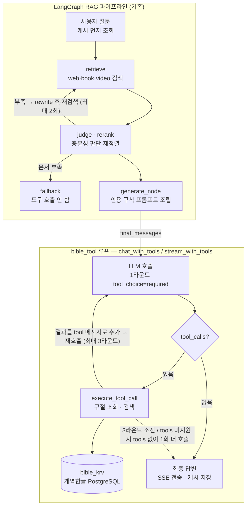

# Tool Calling 정리

## 개요

답변 생성 LLM이 성경 구절을 인용할 때 기억에 의존하지 않고, PostgreSQL에 적재한 **개역한글 원문(`bible_krv`)을 도구로 조회해 그대로 인용**하도록 만든 기능입니다. OpenAI 호환 function calling을 쓰기 때문에 upstage / openai / ollama 어느 PROVIDER에서도 같은 코드로 동작합니다.

| 파일 | 역할 |
| --- | --- |
| `backend/bible_tool.py` (신규, 365줄) | 도구 2종 구현 · 스키마 · 프롬프트 · tool-calling 루프(동기/스트리밍) |
| `backend/load_bible.py` (신규, 131줄) | 개역한글 txt → `bible_krv` 테이블 적재 스크립트 |
| `backend/bbot_graph.py` | 시스템 프롬프트에 인용 규칙 추가, `generate` / `generate_stream`이 루프 함수를 호출하도록 변경 |
| `backend/utils.py` | `strip_think_tags()` 분리 (루프가 문자열을 반환하므로) |
| `backend/test_bible_tool.py` (로컬, 미커밋) | 일괄 실행 후 인용을 DB 원문과 대조하는 테스트 |
| `backend/scripture_strip.py` (`main`) | RAGAS 평가 직전 답변에서 성경 인용 제거 |

같은 브랜치 diff에는 tool calling과 무관한 가드레일/문서판단 프로바이더 분리(`config.py`, `llm_factory.py`, `moderation.py`)도 섞여 있는데, 이는 이미 `main`에 머지된 #18과 겹치는 내용입니다.

## 전체 흐름

기존 RAG 그래프는 그대로이고, 마지막 답변 생성 호출만 tool-calling 루프로 바뀝니다.



문서가 부족해 fallback으로 빠지면 루프에 들어가지 않으므로 도구도 호출되지 않습니다.

## Tool 정의 — 무엇을 조회하나

도구는 2개이고, 둘 다 `bible_krv` 테이블 하나만 읽습니다(쓰기 없음). 결과는 JSON 문자열로 `role: "tool"` 메시지에 담겨 LLM에 되돌아갑니다.

| 도구 | 언제 쓰나 | 인자 | 반환 | 제한 |
| --- | --- | --- | --- | --- |
| `get_bible_verses` | 장절을 알 때, 인용 전 필수 | `book`(필수), `chapter`(필수), `verse_start`, `verse_end` | `translation`, `reference`(예: 요한복음 3:16), `verses[{verse,text}]`, `truncated` | 최대 30절(`MAX_VERSES`), `verse_start` 생략 시 장 전체 |
| `search_bible` | 장절이 확실하지 않을 때 | `keyword`(필수, 공백=AND), `book` | `translation`, `results[{reference,text}]` | 최대 10건(`MAX_SEARCH_RESULTS`) |

**실행되는 쿼리**

```sql
-- get_bible_verses (절 범위 지정)
SELECT verse, text FROM bible_krv
WHERE book_no=%s AND chapter=%s AND verse BETWEEN %s AND %s
ORDER BY verse LIMIT 31;   -- MAX_VERSES+1 로 truncated 판단

-- search_bible ('태초 천지', book='창')
SELECT book_no, chapter, verse, text FROM bible_krv
WHERE text LIKE '%태초%' AND text LIKE '%천지%' AND book_no = 1
ORDER BY book_no, chapter, verse LIMIT 10;
```

**입력 정규화·방어 로직**

- 책 이름 → `resolve_book()`: 66권의 약어 / 정식명 / 영어명과 별칭(아가서, 요한1서, 계시록, Psalm 등)을 공백·점·하이픈 제거 + 소문자로 맞춰 `book_no`(1~66)로 변환
- `verse_end` 생략 시 시작 절 1개, 시작>끝이면 서로 바꿈
- 검색어의 `%`, `_`는 제거해 LIKE 와일드카드 주입 방지, 값은 모두 파라미터 바인딩
- `execute_tool_call()`: 알 수 없는 도구명, JSON 파싱 실패, 인자 오류, DB 오류를 모두 예외 대신 `{"error": ...}`로 돌려줌. 함수 시그니처에 없는 인자는 버림
- 존재하지 않는 장절 → `"창세기 51장은(는) 존재하지 않습니다."` 같은 error 반환 → 프롬프트에 따라 인용하지 않음

**반환 예시** (`get_bible_verses("요", 3, 16)`)

```json
{"translation": "개역한글", "reference": "요한복음 3:16",
 "verses": [{"verse": 16, "text": "하나님이 세상을 이처럼 사랑하사 ..."}],
 "truncated": false}
```

## Tool-calling 루프 로직

최대 3라운드(`MAX_TOOL_ROUNDS`) 동안 "LLM 호출 → tool_calls 있으면 실행 후 결과 추가 → 다시 호출"을 반복하고, tool_calls가 없는 응답이 오면 그것이 최종 답변입니다. `chat_with_tools`(동기, `generate`용)와 `stream_with_tools`(SSE, `generate_stream`용)가 같은 구조입니다.

1. `messages`를 복사(`msgs`)해 원본은 건드리지 않음
2. `client.chat.completions.create(model, msgs, tools=BIBLE_TOOLS, tool_choice=...)` 호출
   - 1라운드: `tool_choice="required"` (`FORCE_FIRST_TOOL=true`일 때) → 무조건 한 번은 도구 호출. 답변 끝에 붙는 마무리 인용까지 원문 보장이 목적
   - 2라운드 이후: `"auto"` (모델 판단)
3. 응답에 `tool_calls`가 없으면 → 그 내용을 최종 답변으로 반환하고 종료
4. 있으면 `_append_tool_results()`
   - `assistant` 메시지(tool_calls 포함)를 추가
   - 각 call마다 `execute_tool_call()` 실행 → `{"role":"tool", "tool_call_id", "content": JSON}` 추가 (한 응답에 여러 call이면 순차 실행)
   - id가 비어 있으면 `call_{i}`로 채움 (Ollama 등 id를 안 주는 프로바이더 대비)
5. 2로 돌아감
6. 3라운드를 다 쓰거나, `tools` 호출 자체가 예외(모델이 tools 미지원 등)이면 → **`tools` 없이** 마지막 호출을 한 번 더 해서 답변을 받음 (도구 결과는 msgs에 남아 있음)

**스트리밍 버전의 차이**

- 청크의 `delta.content`는 바로 `yield` (사용자에게 SSE로 전송)
- `delta.tool_calls`는 `index`별 슬롯에 `id`/`name`을 채우고 `arguments` 조각을 이어붙여 모음 → 스트림이 끝난 뒤 실행
- `choices`가 빈 청크(usage 청크 등)는 건너뜀
- `generate_stream`은 토큰을 받아 `\n`을 `\\n`으로 바꿔 `data: ...` SSE로 내보냄 (기존과 동일)

**그래프와의 연결점**

- `generate_node`는 LLM을 호출하지 않고 `final_messages`만 조립. 시스템 프롬프트 뒤에 `BIBLE_TOOL_PROMPT`를 붙임
- 그래프 밖 어댑터(`generate` / `generate_stream`)가 루프 함수를 호출. 인자: `temperature=0`, Langfuse용 `name=...`, upstage일 때 `reasoning_effort="minimal"`
- 동기 버전은 결과에 `strip_think_tags()`를 적용해 `<think>` 흔적 제거
- `get_client()`가 `langfuse.openai.OpenAI` 래퍼라 라운드별 LLM 호출이 각각 Langfuse에 찍힘. 도구 실행 자체는 `print` 로그만 남음 (`📖 [Tool] get_bible_verses({...}) → 요한복음 3:16`)
- fallback 노드로 빠지면(문서 부족) `generate`를 거치지 않으므로 도구도 호출되지 않음

## DB 구조 — `bible_krv`

개역한글 성경 한 절 = 한 행인 단일 테이블이며, 기존 RAG용 DB(동일한 `DB_HOST`/`DB_NAME`, `config.get_conn()`)에 함께 들어갑니다. 다른 테이블과의 관계나 벡터 컨럼은 없습니다.

```sql
CREATE TABLE IF NOT EXISTS bible_krv (
    book_no   SMALLINT NOT NULL,   -- 1(창세기) ~ 66(요한계시록)
    book_abbr TEXT     NOT NULL,   -- '창', '요', '고전' ...
    book_name TEXT     NOT NULL,   -- '창세기', '요한복음' ...
    chapter   SMALLINT NOT NULL,
    verse     SMALLINT NOT NULL,
    text      TEXT     NOT NULL,   -- 소제목 <...> 제거된 본문
    PRIMARY KEY (book_no, chapter, verse)
);
```

| 컬럼 | 예시 | 비고 |
| --- | --- | --- |
| `book_no` | 43 | `bible_tool.BOOKS` 리스트 인덱스+1 |
| `book_abbr` | 요 | 원본 txt의 약어 |
| `book_name` | 요한복음 | 인용 표기에 쓰는 정식명 |
| `chapter` / `verse` | 3 / 16 | 장 / 절 |
| `text` | 하나님이 세상을 이처럼 사랑하사… | 약 3만 1천 행 |

- PK `(book_no, chapter, verse)`가 곧 `get_bible_verses`의 조회 인덱스
- `search_bible`의 `LIKE '%..%'`는 인덱스를 못 타서 풀스캔(3만 행이라 현재는 문제없는 수준)

**적재 방법 (`load_bible.py`)**

- 입력: `창1:1 태초에 하나님이 천지를 창조하시니라` 형식의 txt (`backend/bible.txt`, gitignore 대상이라 저장소에 없음)
- 인코딩 자동 판별: utf-8-sig → cp949 → euc-kr
- `<천지 창조>` 같은 소제목은 기본 제거(`--keep-headings`로 유지), 형식에 안 맞는 줄은 직전 절에 이어붙임
- `ON CONFLICT ... DO UPDATE SET text` 업서트라 여러 번 실행해도 안전
- 실행 전 검증용 `--dry-run`: 인코딩, 파싱 절 수, 66권 누락 여부, 알 수 없는 약어를 출력

```bash
cd backend
python load_bible.py --file bible.txt --dry-run   # 파싱 확인
python load_bible.py --file bible.txt             # DB 적재
python bible_tool.py 요 3 16                       # 조회 확인
```

## 프롬프트 · 설정값

시스템 프롬프트의 "4. 마무리: 답변 끝에 관련 성경 구절을 한 문장 인용" 지시가 있어 거의 모든 답변에 인용이 들어갑니다. 그래서 그 뒤에 아래 `BIBLE_TOOL_PROMPT`를 붙여 인용 방식을 강제합니다.

```text
[성경 인용 규칙]
- 성경 구절을 인용할 때는 반드시 get_bible_verses 도구로 개역한글 본문을 조회한 뒤,
  조회 결과의 문구를 한 글자도 바꾸지 말고 인용하십시오. 기억에 의존해 본문을 쓰지 마십시오.
- 답변 마무리에 붙이는 한 줄 인용도 예외가 아닙니다. ... 답변 작성 전에 모두 조회하십시오.
- 도구로 조회하지 않은 구절은 본문을 쓰지 말고, 장절만 언급하십시오.
- 장절이 확실하지 않으면 search_bible 도구로 먼저 검색하십시오.
- 도구가 error를 반환하면 그 구절은 인용하지 마십시오.
- 인용 형식: "본문" (요한복음 3:16, 개역한글)
```

인용 형식 `"본문" (책 장:절, 개역한글)`은 `scripture_strip.py`(평가용 제거)와 `test_bible_tool.py`(검증)의 정규식이 의존하므로, 바꾸면 세 곳을 함께 고쳐야 합니다.

| 이름 | 종류 | 기본값 | 의미 |
| --- | --- | --- | --- |
| `ENABLE_BIBLE_TOOL` | 환경변수 | `true` | `false`면 루프를 건너뛰고 기존처럼 도구 없이 1회 호출 (프롬프트는 그대로 붙음) |
| `FORCE_FIRST_TOOL` | 환경변수 | `true` | 1라운드 `tool_choice="required"` 강제 여부 |
| `MAX_TOOL_ROUNDS` | 코드 상수 | 3 | 도구 왕복 최대 횟수 |
| `MAX_VERSES` | 코드 상수 | 30 | 한 번에 반환하는 최대 절 수 (토큰 폭주 방지) |
| `MAX_SEARCH_RESULTS` | 코드 상수 | 10 | 검색 최대 결과 |
| `PROVIDER` / `*_LLM_MODEL` | 환경변수 | — | 답변 생성 모델. function calling + `tool_choice="required"` 지원 필요 |
| `DB_HOST` … `DB_PORT` | 환경변수 | — | `bible_krv`가 있는 DB |

`ENABLE_BIBLE_TOOL`, `FORCE_FIRST_TOOL`은 `.env.example`에 아직 빠져 있습니다.

## 테스트 · 평가

가장 큰 회차(20문항)에서 인용 18건 중 15건이 DB 원문과 일치했고, 16건은 실제로 도구 조회를 거쳤습니다. 다만 평균 응답시간이 66초로 길었습니다.

`test_bible_tool.py`는 캐시 없이 `generate()`를 돌린 뒤 인용마다 장절 존재 / 본문 일치(공백·문장부호 무시) / 이번 답변에서 도구로 조회했는지를 자동 판정하고, 관련성은 CSV에 사람이 O/X로 적도록 합니다. 결과는 `backend/bible_test_logs/`에 있습니다.

| 회차 | 질문 수 | 평균 응답(초) | 도구 호출 | 인용 | 본문 일치 | 도구 조회한 인용 | fallback 답변 |
| --- | --- | --- | --- | --- | --- | --- | --- |
| 09-29 03:01 | 1 | 22.0 | 0 | 0 | — | — | 1 |
| 09-29 02:50 | 7 | 22.7 | 5 | 3 | 3 | 3 | 5 |
| 09-28 21:23 | 20 | 66.3 | 16 | 18 | 15 | 16 | 3 |
| 09-28 21:21 | 3 | 24.1 | 6 | 7 | 5 | 5 | 0 |

- "창조에 관한 성경 구절 세 개를 정확히 인용해 주세요" 같은 직접 요청은 검색 문서 부족으로 fallback에 빠져 도구가 한 번도 호출되지 않았음 (표의 도구 호출 0건)
- 불일치 인용의 원인은 아직 분류하지 않음 → quotes CSV의 '도구 조회' X 행부터 확인 필요
- RAGAS에서는 성경 인용이 검색 문서에 없어 faithfulness가 깎여(실측 0.33), `main`의 `scripture_strip.py`가 평가 큐(`qa_eval_queue`)에 넣기 직전에만 인용을 떼어냄. 사용자 응답·캐시는 그대로

```bash
python test_bible_tool.py                 # 내장 질문 20개
python test_bible_tool.py --limit 5
python test_bible_tool.py --xlsx eval_data.xlsx --column question --limit 50
python bible_tool.py --llm "창세기 1장 1절 말씀 알려줘"   # 루프 단독 테스트
```

**개선 포인트**

| 항목 | 내용 | 제안 |
| --- | --- | --- |
| 응답 지연 | `required` 강제로 모든 답변이 LLM 최소 2회 호출. 20문항 평균 66초 | 라운드별 시간 측정 후 `FORCE_FIRST_TOOL` 효과 비교, 캐시 적중률과 함께 판단 |
| 스트리밍 중간 텍스트 | tool_calls 라운드에서 모델이 쓴 content도 즉시 yield → "구절을 조회하겠습니다" 같은 문장이 답변 앞에 붙을 수 있음 | tool_calls가 없는 라운드인지 확인된 뒤에만 내보내거나 버퍼링 |
| 스트림 중 예외 | 스트림 도중 예외는 `try` 범위 밖이라 그대로 전파됨 (`create` 호출만 보호) | 청크 순회까지 예외 처리 범위 확장 검토 |
| 도구 로그 | 도구 실행이 `print`로만 남고 Langfuse span이 없음 | `logger` + Langfuse span(도구명·인자·reference)으로 교체 |
| DB 연결 | 도구 1회마다 `psycopg2.connect`로 새 연결 | 커넥션 풀 또는 Redis에 구절 캐시 |
| fallback 시 미호출 | "구절 알려줘"류 질문이 문서 부족으로 fallback되면 도구를 써보지도 못함 | 성경 조회 의도면 fallback 대신 도구 전용 경로로 보내는 라우팅 검토 |
| 장 경계 범위 | `창 1:31-2:3`처럼 장을 넘는 범위는 한 번에 조회 불가 | 필요하면 `chapter_end` 인자 추가 |
| 검색 품질 | `LIKE` 부분일치라 어미 변화·띄어쓰기 차이에 약함 | `pg_trgm` 인덱스 또는 형태소 기반 검색 |
| 인용 형식 의존 | 형식을 바꾸면 `scripture_strip.py`·`test_bible_tool.py` 정규식도 깨짐 | 책 이름 목록을 `bible_tool.BOOKS`에서 가져오도록 통일 (현재는 복사본) |
