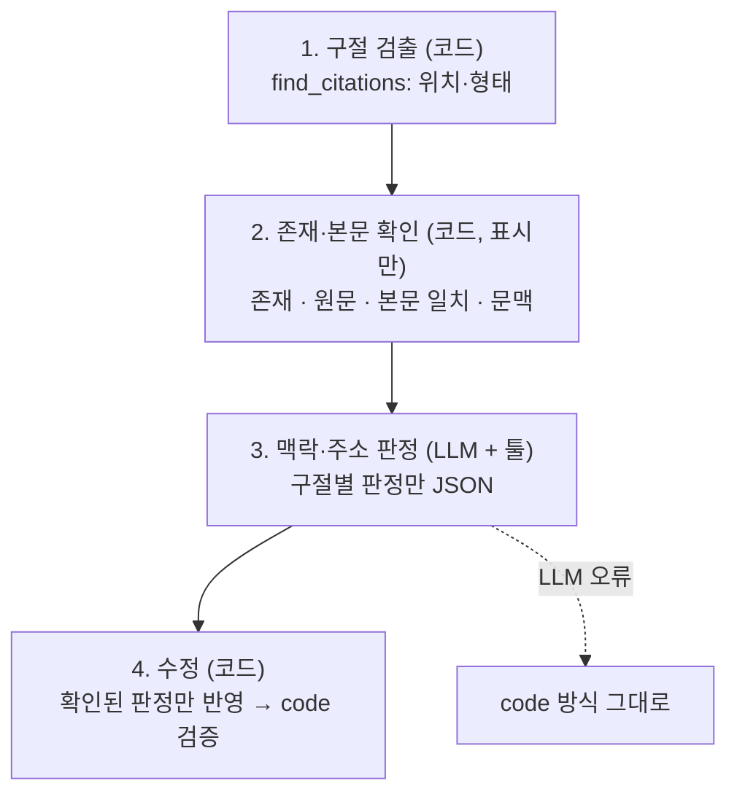
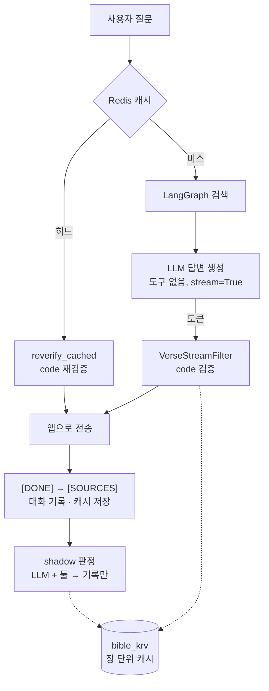

# [트러블슈팅] 성경 구절 환각 검증 — 답변 생성 후 구절 검증 + 맥락·주소 판정

## 요약

| 항목 | 내용 |
| --- | --- |
| 문제 | LLM이 성경 구절을 기억으로 인용해 **원문과 다른 본문**을 씀 (20개 답변 중 19개). 이를 막던 기존 tool calling은 답변 전에 도구를 강제로 불러 **평균 66초** |
| 1차 해결 | 답변은 도구 없이 바로 생성·스트리밍하고, **답변에 포함된 구절만 코드로 원문과 대조** (code 방식) |
| 2차 (랩미팅) | 정규식으로 찾은 구절의 **맥락·주소를 LLM이 툴콜링으로 판정**. LLM은 판정만, 수정은 코드. **당분간 기록만(shadow)** |
| 결과 | code 방식: 답변 완료 **4.1초**, 틀린 인용 **21/21건 원문 교체**, 답변 손상 0건 |
| 정리 | LLM이 답변을 다시 쓰던 tool 방식은 출처·문단을 지워 제거. 설정 7개 → 5개 |
| 브랜치 | `refactor/tool-calling` (main 미머지) |

---

## 1. 문제 상황

### 1-1. 구절 환각

시스템 프롬프트의 "4. 마무리" 규칙이 답변 끝에 성경 구절 인용을 요구해서, 거의 모든 답변에 구절이 들어가요. LLM은 구절을 **기억으로** 쓰기 때문에 원문과 다른 경우가 많았어요.

| LLM이 쓴 인용 | 실제 개역한글 원문 |
| --- | --- |
| "하나님이 보시기에 좋았더라" (창세기 1:31) | 하나님이 그 지으신 모든 것을 보시니 보시기에 **심히** 좋았더라 … |
| "하늘과 땅이 만물의 시작에 창조되었으며" (창세기 1:1) | 태초에 하나님이 천지를 창조하시니라 |
| 로마서 5장 12절에서도 "… 사망이 왔으니"라고 | 이러므로 … 죄로 말미암아 사망이 **왔나니** … |

### 1-2. 기존 해결책(tool calling)의 한계

- 첫 LLM 호출에서 도구 사용을 **강제** (`tool_choice="required"`), 도구 왕복 최대 3라운드
- 인용 18건 중 15건 일치, **평균 응답 66초**
- 구절이 필요 없는 질문도 도구를 무조건 호출

### 1-3. 교수님 피드백

- 최종 답변이 생성되었을 때 툴콜링이 필요한지 아닌지 확인하고 호출하기
- generate된 답변에 성경 구절이 포함되어 있는지 확인하고 툴 호출
- 성경이 맞는 구절인지 / 실제로 존재하는 구절인지 확인 ← 없는 구절이면 없애기 or 제대로 된 구절 찾기(나중에)

→ 핵심은 **"무조건 먼저 부르지 말고, 답변을 먼저 만든 뒤 필요할 때만"**.

### 1-4. 랩미팅 의견 (2026-10-27)

"정규식으로 구절 인용 부분을 찾고, **맥락 파악과 주소·구절 오류는 tool-calling으로**"

---

## 2. 원인 분석

| 원인 | 설명 |
| --- | --- |
| 도구 호출 시점 | 답변 **전**에 강제 호출 → 구절 유무와 관계없이 LLM 호출이 최소 2회 |
| 검증 주체 | 원문 대조를 LLM에게 맡김 → 조회해도 그대로 옮겨 쓰지 않는 경우가 남음 |
| 스트리밍 | 도구 왕복이 끝나야 답변이 시작돼 첫 글자까지 오래 걸림 |
| 프롬프트 | "마무리에 구절 인용" 규칙 때문에 LLM이 매번 기억으로 인용 (근본 원인, 남은 과제) |

---

## 3. 해결 방향 — 검토한 대안

| 대안 | 판단 |
| --- | --- |
| 사후 검증 (답변 생성 후 구절 확인) | ✅ 채택 (교수님 피드백과 일치) |
| HyDE (초안을 검색 쿼리로) | 생성 2회 → 느림 |
| 임베딩 검색으로 구절 붙이기 | 기존 인용의 진위 확인이 안 됨 |
| 1단계 구절 인용 금지 | 교수님 피드백(인용 허용 후 검증)과 반대 |

### 스트리밍과의 충돌

| 방법 | 판단 |
| --- | --- |
| 수정 이벤트(`[REPLACE]`) | 틀린 구절이 잠깐 보임, Flutter 수정 필요 |
| **구절만 붙잡기** | ✅ 채택. 백엔드만 수정, 틀린 구절이 화면에 안 나옴 |
| 다 만든 뒤 전송 | 첫 글자까지 너무 오래 걸림 |

---

## 4. 1차 해결 — code 방식 (코드로 원문 대조)

### 4-1. 검증 규칙

| 답변 속 형식 | 처리 |
| --- | --- |
| 장만 (`창세기 5장`, `시편 23편`) | 장이 존재하는지만 확인 |
| 3절 이하 (`창세기 1:1`, `1장 1-3절`, `9장 12절에서 14절`) | 존재 확인 + 인용 본문이 원문과 다르면 **원문으로 교체** |
| 4절 이상 (`창세기 1:1-10`) | 존재 확인만. 인용 본문이 틀리면 본문 빼고 주소만 |
| 없는 구절 | `"본문" (출처)`·`(출처)`는 통째로 삭제, 문장 속 언급은 `성경`으로 치환 |
| 본문 없이 주소만 | 그대로 두고 답변 끝 **참고 구절**에 원문 표시 |

- 본문 대조: **공백·문장부호를 빼고**, 인용문이 원문 안에 포함되는지 확인 (부분 인용 허용)
- 책 이름은 정식 명칭만 인식 (`약 3:1`(대략) 같은 오탐 방지)

### 4-2. VerseStreamFilter — 구절만 붙잡기

1. 구절 신호 찾기: **따옴표 `"`**, **여는 괄호 `(`**, **책 이름 첫 글자**
2. 신호 앞 글자는 바로 전송, 신호부터는 붙잡음
3. 아직 모름 → 대기 / 구절 아님 → 그대로 전송 / 구절 확정 → 검증 후 전송
4. 답변이 끝나면 `finish()`가 남은 글자 처리 + 참고 구절 추가

| 들어온 토큰 | 판단 | 앱 화면 |
| --- | --- | --- |
| `세상은 설계되었습니다. ` | 신호 없음 | `세상은 설계되었습니다.` |
| `"태초에 하나님께서` | 따옴표 → 붙잡기 | (변화 없음) |
| ` 하늘과 땅을 만드셨다"` | 따옴표 닫힘, 괄호 대기 | (변화 없음) |
| ` (창세기 1:1)` | 구절 확정 → 원문과 다름 → 교체 | `"태초에 하나님이 천지를 창조하시니라" (창세기 1:1)` |

- 틀린 인용은 화면에 한 글자도 나가지 않음 / 토큰이 어떻게 쪼개져도 결과 동일
- 캐시에서 꺼낸 답변도 code 방식으로 재검증 (`reverify_cached`)

### 4-3. 원문 출처

- 운영 DB `bible_krv`에서 **장 단위로 조회 → 메모리 캐시**(최대 512장), 실패 시 `bible.txt`
- DB 31,101절과 `bible.txt` 전수 비교: 차이 0건

---

## 5. 비교 실험 — code vs tool (2026-10-21)

tool 방식: 구절이 있을 때만 LLM이 툴로 조회하고 **답변 텍스트를 다시 씀** (+ code 안전장치).

| | code | tool | tool (안전장치 끔) |
| --- | --- | --- | --- |
| 첫 글자 | 0.9초 | 0.9초 | 0.9초 |
| 답변 완료 | **4.1초** | 7.7초 | 7.7초 |
| 틀린 인용 21건 처리 | **21건 교체** | 17건 | 11건 |
| 있는 구절의 출처 삭제 (49개 중) | 0 | **16** | 17 |
| 본문이 85% 미만으로 줄어든 답변 | 0 | **3** | 3 |

- 프롬프트에 "구절 밖은 한 글자도 바꾸지 말 것"을 넣었는데도 LLM이 **설명 문단을 통째로 삭제** (Q4 하와 갈빗대 66%, Q6 노아 방주 51%)
- 출처만 지워 틀린 인용이 안전장치에도 안 걸림 (Q6, Q9)
- → 원인: **LLM에게 텍스트 전체를 다시 쓰게 한 구조**. tool 방식은 제거

---

## 6. 2차 — 맥락·주소 판정 (랩미팅 → LLM은 판정만, 수정은 코드)

### 6-1. 4단계 (동시가 아니라 순서대로 — 코드 결과가 LLM 입력)



### 6-2. 판정 로직 (`bible_verse_judge.judge_citations`)

**입력**
- 시스템 프롬프트: "성경 인용 판정기. 텍스트를 고쳐 쓰지 말고 판정만 JSON으로"
- 답변(뒤쪽 최대 3,000자) + 구절별 정보 블록

```
[인용 2]
- 형태: 따옴표 인용
- 주소: 창세기 1:31
- 인용문: 하나님이 보시기에 좋았더라
- 존재: 예
- 원문(개역한글): 하나님이 그 지으신 모든 것을 보시니 보시기에 심히 좋았더라 …
- 본문 일치: 아니오
- 문맥: (해당 문장 + 앞 문장)
```

**판정 값**

| 판정 | 뜻 |
| --- | --- |
| `ok` | 주소·인용·맥락 모두 맞음 |
| `wrong_ref` | 인용문이 다른 구절의 것 → `suggested_ref` (search_bible로 찾고 get_bible_verses로 확인한 뒤에만) |
| `quote_wrong` | 주소는 맞는데 인용문을 다르게 씀 (줄이거나 풀어 쓴 경우 포함) |
| `context_mismatch` | 구절은 정확하지만 문맥의 주장을 뒷받침하지 않음 |
| `not_found` | 존재하지 않는 구절 |

**툴 루프**
- 툴 2개: `get_bible_verses(book, chapter, verse_start, verse_end)`, `search_bible(keyword, book)` (키워드 AND, 최대 10건)
- `tool_choice="auto"` (원문을 미리 주므로 필요할 때만), temperature 0, 최대 4라운드 → 소진 시 툴 없이 1회 더
- 툴 오류는 예외 대신 `{"error": ...}`로 LLM에 돌려줌

**응답 해석 (`_parse_verdicts`)**: `<think>` 제거 → JSON 추출 → 없는 id·규칙에 없는 판정 값은 버림

### 6-3. 판정 반영 (`bible_verify.apply_verdicts`) — 코드가 확인할 수 있는 것만

| 판정 | 처리 |
| --- | --- |
| `ok` | 그대로 |
| `quote_wrong` / `not_found` | 손대지 않음 → 이어지는 code 검증이 원문 교체·삭제 |
| `context_mismatch` | `VERSE_CONTEXT_ACTION=log` 기록만 / `remove` 삭제 |
| `wrong_ref` | 추천 주소 파싱 → 존재 → 절 단위 3절 이하 → 인용문 있음 → 원문과 유사도 ≥0.75 **모두 통과할 때만** 주소 교체 + 인용문을 새 원문 구간으로. 아니면 `rejected` 기록 |

```
전: "하나님이 보시기에 좋았더라" (창세기 1:31)
후: "하나님의 보시기에 좋았더라" (창세기 1:10)
```

→ 어떤 경우에도 결과가 code 방식보다 나빠지지 않도록 설계

### 6-4. 모드 (`VERSE_JUDGE_MODE`)와 결정

| 모드 | 동작 | 사용자 체감 |
| --- | --- | --- |
| **`shadow` (기본)** | 답변을 다 보낸 **뒤** 판정해 Langfuse `verse-judge-shadow`·로그에만 기록 | 변화 없음 |
| `apply` | 첫 절 단위 구절부터 답변 끝까지 붙잡고 판정 반영 후 전송 | 약 3초 늦어짐 |
| `off` | 판정 안 함 | 변화 없음 |

**결정: 판정이 맞는지 아직 판단하기 어려워 당분간 기록만(shadow).** 기록이 쌓이면 검토 후 apply 여부 결정.

### 6-5. 오프라인 평가 1차 (`eval_verse_judge.py`, 구절 49개)

| 판정 | 개수 |
| --- | --- |
| ok | 12 |
| quote_wrong | 33 |
| context_mismatch | 4 |
| wrong_ref | 0 |

- 판정 시간 답변당 평균 3.3초, 툴 호출은 2개 답변에서만
- 코드가 찾은 틀린 인용 21건을 LLM도 전부 같은 판정
- **코드가 놓친 틀린 인용 11건 발견**: 주소 뒤에 오는 인용(`로마서 5장 12절에서도 "…"라고`), 출처와 떨어진 인용
- context_mismatch는 신뢰도 낮음 (`창세기 1장`이 "하루 24시간"을 뒷받침하지 않는다 — 논쟁적). `9장 12절에서 17절까지`를 9:12로만 읽은 코드 버그도 발견 → 수정

---

## 7. 최종 구조

### 7-1. 전체 흐름



### 7-2. 파일 (`backend/`)

| 파일 | 역할 |
| --- | --- |
| `bible_verify.py` | 원문 조회, 구절 검출, code 검증, `VerseStreamFilter`, `find_citations`, `apply_verdicts`, `reverify_cached` |
| `bible_verse_judge.py` | 판정 LLM 루프, 툴 `get_bible_verses`·`search_bible`, `run_shadow` |
| `bbot_graph.py` | 필터·판정 연결, shadow 실행, 성경 인용 규칙 프롬프트 |
| `scripture_strip.py` | RAGAS 평가 입력에서 참고 구절 제거 |
| `eval_verse_judge.py` | 판정 오프라인 평가 (구절별 CSV, 사람판정 칸) |
| `compare_verse_modes.py` | code / judge 비교 실험 |
| `test_bible_verify.py`, `test_bible_verse_judge.py` | 단위 테스트 19 + 16개 |

### 7-3. 설정 (`.env`, 5개 — 서버 재시작 시 반영)

| 키 | 기본값 | 설명 |
| --- | --- | --- |
| `VERSE_VERIFY_MODE` | `code` | `code` / `off`. off면 apply 판정도 꺼짐 |
| `APPEND_REFERENCE_VERSES` | `true` | 주소만 언급된 3절 이하 구절 원문을 끝에 (최대 3개) |
| `VERSE_JUDGE_MODE` | `shadow` | `shadow` / `apply` / `off`. 캐시·차단·fallback 답변은 판정 안 함 |
| `VERSE_CONTEXT_ACTION` | `log` | `log` / `remove`. apply면 답변에, shadow면 '반영했다면' 기록에 영향 |
| `BIBLE_SOURCE` | `db` | `db` / `file`. DB 데이터 수정 시 재시작 필요(캐시) |

제거: `VERSE_VERIFY_MODE=tool`, `VERSE_TOOL_SAFETY_NET`(tool 방식), `ENABLE_VERSE_VERIFY`(off와 중복)

---

## 8. 개발 중 만난 이슈

| 이슈 | 원인 | 해결 |
| --- | --- | --- |
| `시편 23편` 인식 안 됨 | 정규식이 `장`만 지원 | `[장편]`으로 확장 |
| `9장 12절에서 17절까지`가 9:12로 잘림 | `에서`로 잇는 범위 미지원 | 범위 표기 추가, 스트리밍 중 끝 절까지 대기 |
| 참고 구절에 `{다윗의 시}` 노출 | 시편 표제 | 표시할 때 머리글 제거 |
| 참고 구절 중복 (6:19와 6:19-20) | 범위 포함 관계 미처리 | 포함되는 구절 제외 |
| tool 방식 LLM이 출처·문단 삭제 | 텍스트 전체를 다시 쓰게 함 | 판정만 받고 수정은 코드로 (구조 변경) |
| 비교 실험에서 code만 느리게 측정 | 먼저 도는 방식만 DB 비용 | 원문 캐시를 미리 채움 |
| `TypeError: … extra_items` | langchain_protocol 0.0.15가 3.13+ 문법 | `deploy/patch_langchain_protocol.sh`와 같은 패치 |
| `requirements.txt` 설치 실패 | 고정 버전 충돌, pip resolver 오류 | `uv pip`로 설치 |

---

## 9. 남은 과제

- [ ] 스테이징(emptycan)에서 스트리밍·shadow 기록 확인
- [ ] shadow 기록 확인 방법·주기 정하기 → 판정 정확도 검토 → apply 여부 결정
- [ ] 프롬프트 "4. 마무리" 수정 검토: 구절 본문 대신 주소만 쓰게 하고 원문은 참고 구절로 (틀린 인용의 근본 원인 제거)
- [ ] 주소 뒤 인용문(`주소에서 "…"라고`) 코드 검출·대조
- [ ] 영어 답변 구절 검출 (`Genesis 1:1`)
- [ ] 없는 구절 삭제 후 문장 어색함, 없는 구절 대신 올바른 구절 찾기
